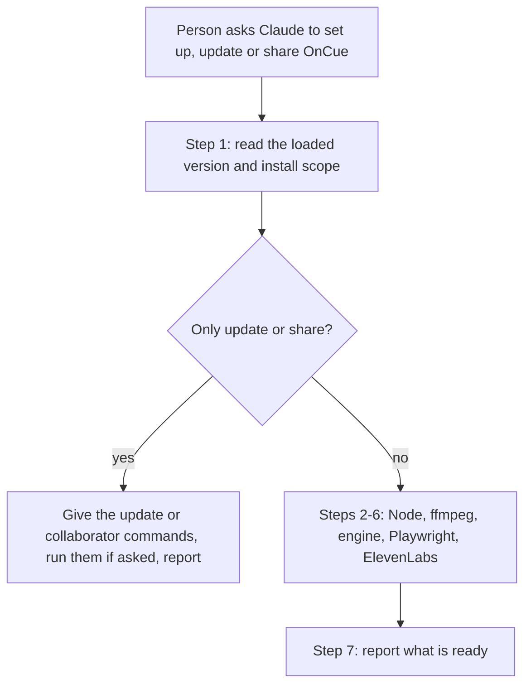
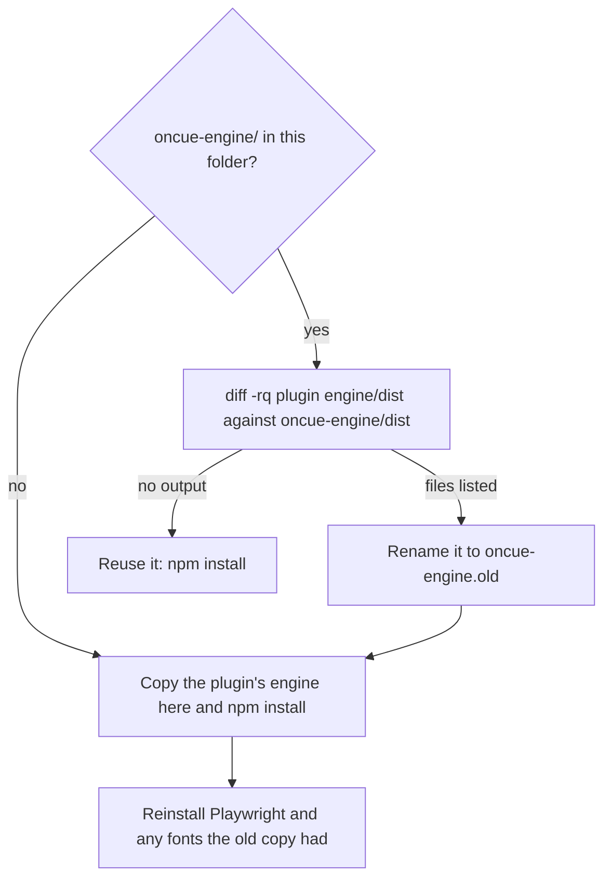

# OnCue install and updates

## At a glance

- Changes: 3
- Files: 4
- Decisions: 6
- Open items: 4

OnCue's setup skill now covers the plugin itself as well as what it needs on the machine. When someone says "set up OnCue", "update OnCue" or "share OnCue with my team", Claude first reports which version is loaded and how it was installed, then gives the commands for the change they asked for. An update now also reaches project folders that already hold a copy of the engine: before, those folders kept running the old engine without saying so. The release is OnCue 1.2.0, in pull request 7, open against `main` with its `validate` check passing.

## What changed

### Setup starts with the plugin itself

- **Affects:** OnCue users, and teammates installing it in a shared repository.
- **What is different:** `/oncue:setup` has a new first step. It reads the loaded version from `plugins/oncue/.claude-plugin/plugin.json`, runs `claude plugin list --json` to find the install scope that applies to the current folder, and flags an update that is on disk but not loaded yet. It then gives the commands to update OnCue or to install it for collaborators. It runs them only when the person asks for that change, and when they only asked to update or share, it stops after this step instead of running every dependency check.
- **How to reach it:** ask Claude to "set up OnCue", "update OnCue" or "share OnCue with my team", or run `/oncue:setup`.

### Old engine copies are replaced after an update

- **Affects:** anyone who updates OnCue and already made a Short in a folder.
- **What is different:** the setup and explainer-video skills used to reuse any `oncue-engine/` folder they found. Now they first run `diff -rq <plugin>/engine/dist oncue-engine/dist`. No output means the copy matches the loaded plugin and is reused. Any difference means an older OnCue made it: the copy is renamed to `oncue-engine.old`, a fresh one is made, and Playwright and any fonts the old copy had are reinstalled in it. The storyboard, vertical-deck and animate-short skills set up the engine through explainer-video, so they get the same check.
- **How to reach it:** automatic, the next time any OnCue stage runs in that folder.

### README and version 1.2.0

- **Affects:** people reading the README, and anyone tracking releases.
- **What is different:** the Install section explains updating (OnCue's marketplace does not auto-update by default) and project-scope installs. The setup row in the skills table mentions updates, and there is a 1.2.0 changelog entry. `plugin.json` moves from 1.1.0 to 1.2.0.
- **How to reach it:** `README.md`, sections Install, Run one stage at a time, and Changelog.

## How it works now

Diagram 1, the setup flow: step 1 checks the plugin, and a request only to update or share ends there.

Diagram 2, the engine copy check: an existing copy is reused only when its compiled engine matches the loaded plugin.

## Before and after

| Situation | Before | After |
| --- | --- | --- |
| "Set up OnCue" | Checked Node, ffmpeg, the engine, Playwright and ElevenLabs | Reports the plugin's version and install scope first, then runs the same checks |
| "Update OnCue" | No skill handled it | Setup gives the update command, tells the person to reload, and stops after step 1 |
| "Share OnCue with my team" | No skill handled it | Setup gives the project-scope install command and the one each collaborator runs |
| An update is downloaded but not loaded | Not mentioned | Flagged: run `/reload-plugins` or start a new session |
| Commands that change Claude Code settings | Not offered | Offered, and run only when the person asks for that change |
| `oncue-engine/` made by an older OnCue | Reused: the old engine kept running | Detected, renamed aside, and replaced with a fresh copy |
| Playwright and fonts in the old copy | Not applicable | Reinstalled in the fresh copy; the old copy is kept until the person deletes it |

## Decisions

1. **Extend the setup skill instead of adding an install skill.** A separate install skill would trigger on the same requests ("set up", "install", "update"), and no skill inside a plugin can run before the plugin is installed, so its only real jobs were updating, scope and sharing, all of which fit as one step of setup. Rejected: a new `install` skill, which would duplicate setup's triggers.
2. **Detect an old engine copy by comparing `engine/dist`.** The compiled engine is the part an update changes, and the user never edits it. Rejected: comparing the engine's `package.json` version, which stayed at 1.0.0 when 1.1.0 changed `dist/capture.js`; and comparing `package.json` contents, which always differ because Playwright and fonts are saved into the copy.
3. **Rename the old copy aside rather than copy over it or delete it.** `cp -R` onto an existing folder nests the engine inside it, overwriting `package.json` would drop the saved Playwright and fonts, and deleting is not reversible. Renaming loses nothing, and the person deletes the old copy once the new one works.
4. **Give the commands and run them only on request.** Plugin scope and updates live in the person's Claude Code settings. Rejected: running `claude plugin update` or a project-scope install automatically.
5. **Keep "Claude Code 2.1.292 or later" in the collaborator command.** The review suggested removing it as unsourced. The Claude Code docs state that minimum for installing with `--marketplace` from a shell, so it stays.
6. **Release as 1.2.0.** The repository's CLAUDE.md asks for a version bump when what a skill does changes. Two plans on `main` also name 1.2.0 for later work, so whichever lands next takes the following minor version.

A fresh-context review of the branch found no critical defects. Its confirmed findings were fixed in commit a1d846d: choose the `oncue@oncue` entries that apply to this folder, stop after step 1 for update-only and share-only requests, drop `--scope` from the update command (it auto-detects), and define `<plugin>` in the explainer-video skill. One claim the review did not flag was also corrected: OnCue's marketplace entry is a relative path, which the docs say can load without an install record, so "a project-scope install never downloads OnCue for collaborators" was too broad.

## Learnings

- `claude plugin list --json` returns one entry per scope and project, so a plugin installed in several repositories appears many times under the same `id`. Picking "the" entry needs the folder.
- `claude plugin update` auto-detects the scope, and its output says a restart is needed; `/reload-plugins` or a new session loads the update.
- Marketplace plugins outside Anthropic's official marketplaces do not auto-update unless the person turns it on under `/plugin`, Marketplaces.
- A plugin update changes only the plugin cache. Any copy of the plugin's files in a working folder stays as it was, which is how the 1.1.0 engine change never reached folders set up under 1.0.0.

## Open items

- **Version collision.** This PR takes 1.2.0, and `docs/plans/add-research-and-visuals-skills.md` and `docs/plans/add-elevenlabs-credits-status.md` on `main` also plan a 1.2.0. Whichever of those lands after this PR should bump to the next minor version and update its plan.
- **CodeRabbit did not review.** Its comment on the PR reports a review rate limit, so the only review so far is the fresh-context review described above. The `validate` check passes.
- **Not run in a live session.** The new step 1 and the engine copy check were checked by `npm run validate`, against `claude plugin --help` and the Claude Code docs, and by running the `diff -rq` check on a fresh copy and a 1.0.0 copy in a scratch folder. Nobody has yet run `/oncue:setup` after a real plugin update.
- **Old copies left behind.** Each update that replaces an engine copy leaves an `oncue-engine.old` folder, with its `node_modules`, until the person deletes it. Setup tells them, but nothing deletes it for them.

## Files touched

- **Skills**
  - `plugins/oncue/skills/setup/SKILL.md`: new step 1 for the plugin (version, scope, update, collaborators), the engine copy check in step 4, later steps renumbered, and the report covers the plugin.
  - `plugins/oncue/skills/explainer-video/SKILL.md`: the same engine copy check, and a definition of `<plugin>`.
- **Docs**
  - `README.md`: updating and project-scope installs under Install, the setup row in the skills table, and the 1.2.0 changelog entry.
- **Release**
  - `plugins/oncue/.claude-plugin/plugin.json`: version 1.1.0 to 1.2.0.

## Glossary

- **OnCue:** a Claude Code plugin that turns a topic into a vertical explainer video, a 9:16 slide deck and a voiceover.
- **Plugin:** a package of skills and other extensions that Claude Code installs from a marketplace.
- **Marketplace:** a catalog of plugins; OnCue's is the GitHub repository `shawn-sandy/oncue`, registered under the name `oncue`.
- **Skill:** a set of instructions Claude follows for one kind of task, such as `setup` or `explainer-video`.
- **Install scope:** who gets a plugin. User scope is you in every project, project scope is everyone in a repository (recorded in its committed `.claude/settings.json`), and local scope is you in one repository only.
- **Engine:** OnCue's Node program that renders the deck, stills and video from `short.json`.
- **`oncue-engine/`:** the copy of the engine that OnCue's skills make in the working folder, so installing packages never touches the plugin's own files.
- **`dist/`:** the engine's compiled JavaScript, shipped with the plugin; the part an OnCue update changes.
- **Playwright:** the library that drives a headless Chromium browser to draw the video frames.
- **`@fontsource` packages:** npm packages that supply fonts a brand asks for.
- **`/reload-plugins`:** the Claude Code command that loads plugin changes into the running session.
- **`diff -rq`:** a shell command that compares two folders and lists only the files that differ.
